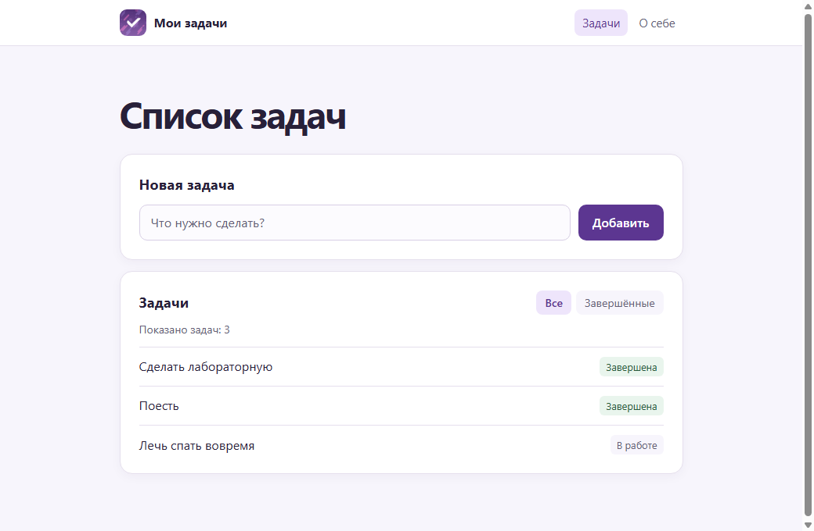
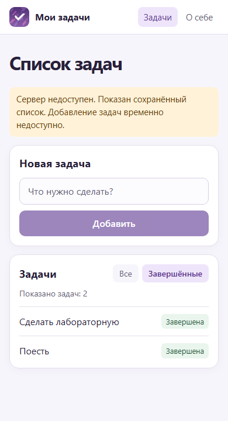

# Лабораторная работа № 6. Список задач

Вариант 8 · Даниил Левченко, группа 932402

## Задача

«Мои задачи» — учебное веб-приложение для ведения простого списка дел. Можно добавить задачу, посмотреть весь список или отфильтровать завершённые. Лабораторная показывает, как браузер взаимодействует с сервером через JSON API и как обычный сайт становится устанавливаемым приложением с офлайн-просмотром (PWA).

## Стек

- **Node.js и npm** — запуск сервера и управление зависимостями.
- **Express 5** — HTTP-маршруты, JSON API и раздача статики из каталога `public`.
- **HTML, CSS и JavaScript** — адаптивный интерфейс и запросы к API через `fetch`.
- **Web App Manifest, Service Worker и Cache API** — установка приложения и кеширование страниц. `localStorage` хранит последний загруженный полный список для офлайн-просмотра.

## Запуск

Для запуска нужны Node.js и npm. Выполните команды в каталоге `lab6`.

```powershell
npm.cmd ci
npm.cmd start
```

Откройте [http://localhost:3000](http://localhost:3000).

## Маршруты

| Метод и путь | Что возвращает |
| --- | --- |
| `GET /` | Страница списка задач |
| `GET /about` | Страница об авторе |
| `GET /api/status` | Состояние сервера в JSON |
| `GET /api/tasks` | Все задачи |
| `GET /api/tasks?completed=true` | Завершённые задачи |
| `GET /api/tasks/:id` | Задача по ID или `404` |
| `POST /api/tasks` | Новая задача и код `201`. Пустой, пропущенный или нестроковый `title` даёт `400`. |

Пример запроса из PowerShell:

```powershell
Invoke-RestMethod http://localhost:3000/api/tasks -Method Post -ContentType 'application/json' -Body '{"title":"Check the API"}'
Invoke-RestMethod 'http://localhost:3000/api/tasks?completed=true'
Invoke-RestMethod http://localhost:3000/api/tasks/1
```

`req.params.id` читает часть пути, `req.query.completed` читает параметр после `?`, а `req.body.title` читает поле из JSON. Express Router в `src/tasks.js` группирует маршруты задач, как контроллер в Spring MVC. Массив в том же модуле хранит задачи. У каждой новой задачи `completed: false`, а завершённые примеры позволяют проверить фильтр сразу. При перезапуске сервера остаются только исходные примеры.

## Проверка PWA

1. Откройте главную с запущенным сервером и дождитесь списка. В Chrome DevTools в разделе **Application → Service workers** дождитесь активации `/sw.js`.
2. Переключите **Network** в режим **Offline**, обновите главную и перейдите на страницу «О себе». Обе страницы должны открыться. На главной можно фильтровать последний загруженный список, а кнопка добавления будет отключена.
3. Верните **Network** в обычный режим. Для установки используйте команду установки в меню Chrome или Edge, если браузер её показывает.

Service worker кеширует HTML, CSS, JavaScript, манифест и иконки. Последний полный список хранится в `localStorage` для офлайн-просмотра. Добавление через API требует работающего сервера.

## Скриншоты

### Главная страница



### Офлайн-режим на мобильном экране


