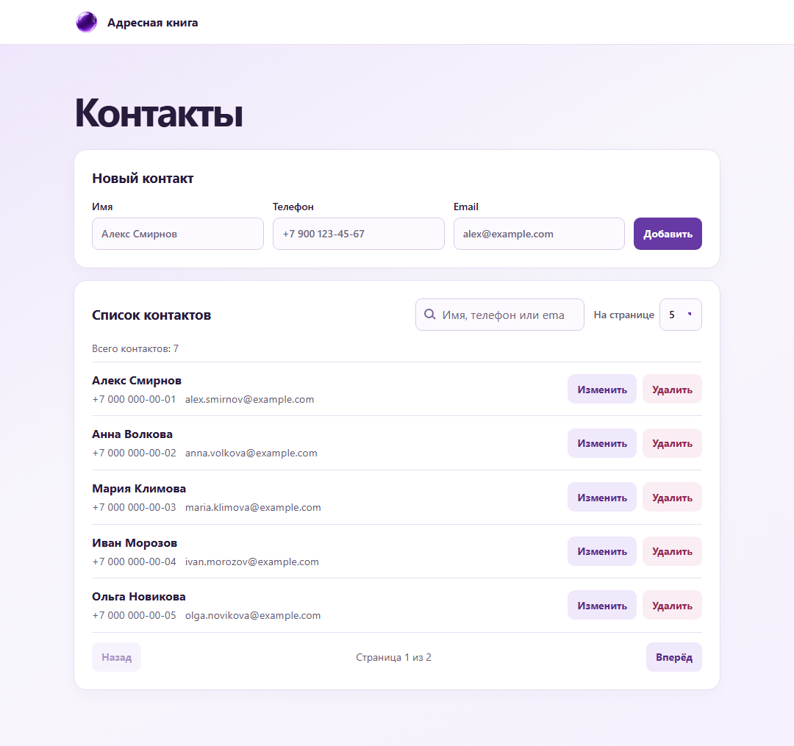
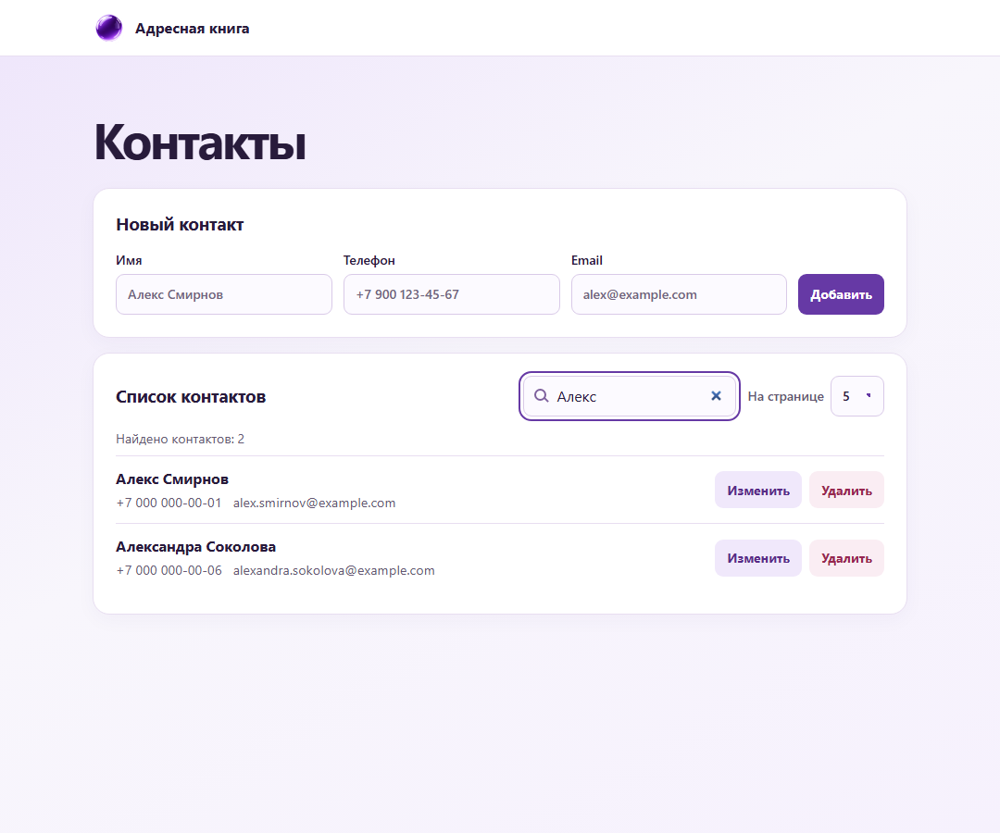
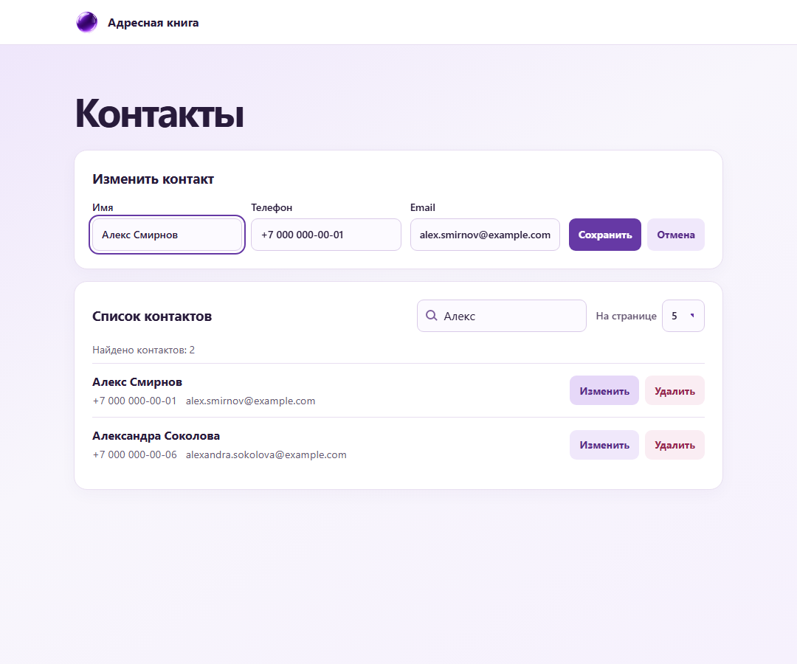

# Лабораторная работа № 7. Контакты

## Задача

**Вариант 8 — «Контакты».** Цель работы — освоить CRUD-операции в реляционной базе данных и связать их с маршрутами Express. Для этого реализована адресная книга, в которой можно добавлять, просматривать, редактировать и удалять контакты прямо в браузере.

Поиск работает по имени, телефону и email. Список разбивается на страницы, а API возвращает количество совпадений до пагинации в поле `total`. Контакты хранятся в таблице `contacts` с полями `id`, `name`, `phone` и `email`. Идентификатор `id` генерируется базой данных.

## Стек

| Технология | Назначение |
| --- | --- |
| Node.js 22.9+ и Express 5 | HTTP-сервер, REST API и раздача файлов интерфейса |
| PostgreSQL и драйвер `pg` | Хранение контактов и выполнение параметризованных SQL-запросов |
| HTML, CSS и JavaScript | Одностраничный интерфейс и вызовы API через `fetch` |

## Запуск

Понадобятся Node.js 22.9 или новее, npm и запущенный PostgreSQL.

1. Если базы `lab7_contacts` ещё нет, откройте SQL-редактор DBeaver для любой существующей базы, например `postgres`. В режиме **Auto-commit** выполните команду через **Ctrl + Enter**. У пользователя PostgreSQL должно быть право создавать базы данных.

   ```sql
   CREATE DATABASE lab7_contacts;
   ```

2. В PowerShell из папки `web_labs` перейдите в `lab7` и установите зависимости.

   ```powershell
   cd lab7
   npm ci
   ```

3. Создайте или откройте файл `.env` в папке `lab7`. Укажите логин и пароль из вашего подключения к PostgreSQL. При необходимости измените хост и порт базы. У пользователя должно быть право создавать таблицы в `lab7_contacts`.

   ```dotenv
   PORT=3007
   PGHOST=localhost
   PGPORT=5432
   PGDATABASE=lab7_contacts
   PGUSER=postgres
   PGPASSWORD="ваш_пароль_PostgreSQL"
   ```

4. Выполните `npm start` из папки `lab7`. Сервер создаст таблицу `contacts` из `schema.sql`, если её ещё нет. Откройте [страницу контактов](http://127.0.0.1:3007/) в браузере.

## Скриншоты работы

### Список контактов и пагинация



### Поиск по запросу «Алекс»



### Редактирование контакта



## Маршруты

| Метод и путь | Действие | Успешный ответ |
| --- | --- | --- |
| `GET /api/contacts` | Получить список контактов | `200 OK` |
| `POST /api/contacts` | Создать контакт | `201 Created` и созданный контакт |
| `PUT /api/contacts/:id` | Заменить имя, телефон и email | `200 OK` и обновлённый контакт |
| `DELETE /api/contacts/:id` | Удалить контакт | `204 No Content` |

Для `POST` и `PUT` передайте JSON с непустыми строками `name`, `phone` и `email`. Некорректные данные дают `400 Bad Request`. При обновлении или удалении отсутствующего контакта API возвращает `404 Not Found`.

Для `GET` можно передать `q` для поиска по подстроке в имени, телефоне или email без учёта регистра. `page` и `limit` должны быть положительными целыми числами. По умолчанию используются `page=1` и `limit=10`. Отрицательный `limit` даёт `400 Bad Request`. Ответ содержит `contacts`, `total`, `page` и `limit`. Поле `total` показывает число контактов, подходящих под поиск, до применения пагинации. Без `q` оно показывает число всех контактов.

## Проверка через PowerShell

```powershell
$api = 'http://127.0.0.1:3007/api/contacts'
$body = @{ name = 'Alex'; phone = '+79991234567'; email = 'alex@example.com' }
$created = Invoke-RestMethod -Uri $api -Method Post -ContentType 'application/json' -Body ($body | ConvertTo-Json)

Invoke-RestMethod -Uri "${api}?q=Alex&page=1&limit=10"
Invoke-RestMethod -Uri "${api}?q=Alex&page=2&limit=10"

$contactUrl = "$api/$($created.id)"
$body.name = 'Alexander'
Invoke-RestMethod -Uri $contactUrl -Method Put -ContentType 'application/json' -Body ($body | ConvertTo-Json)
Invoke-RestMethod -Uri $contactUrl -Method Delete

# Ожидается HTTP 400
Invoke-RestMethod -Uri "${api}?limit=-1"
```
