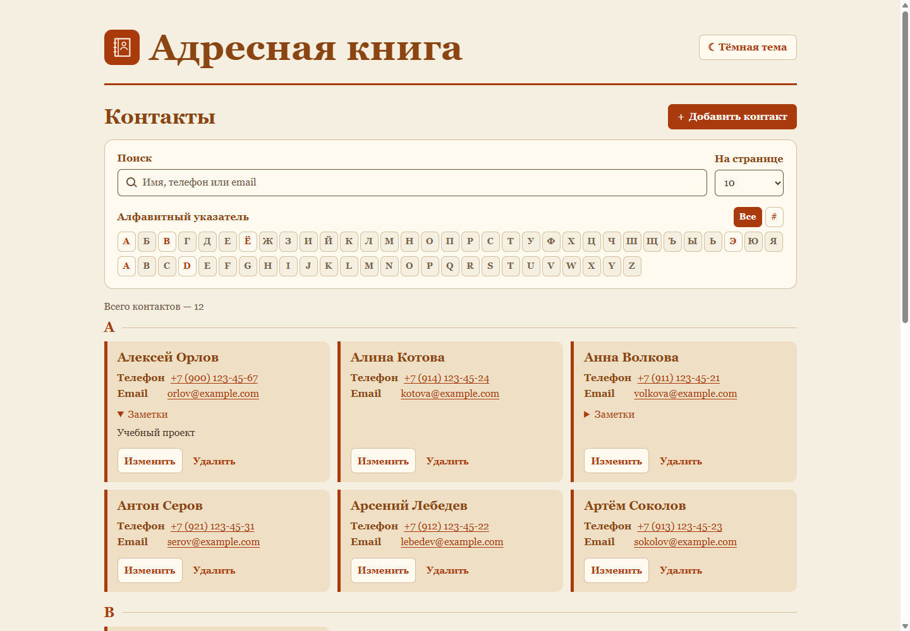
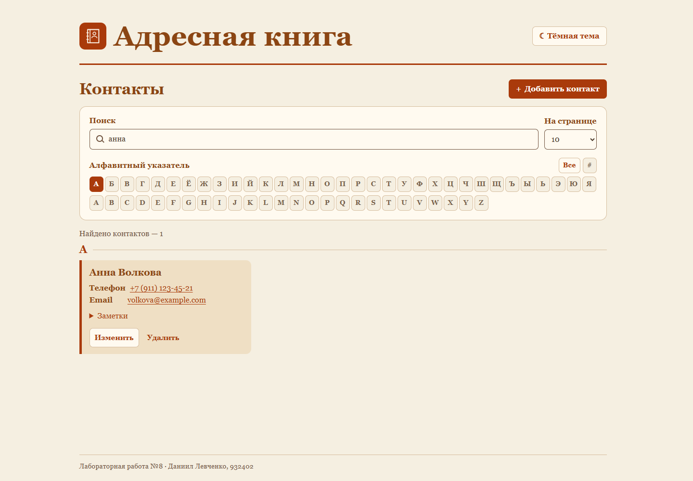
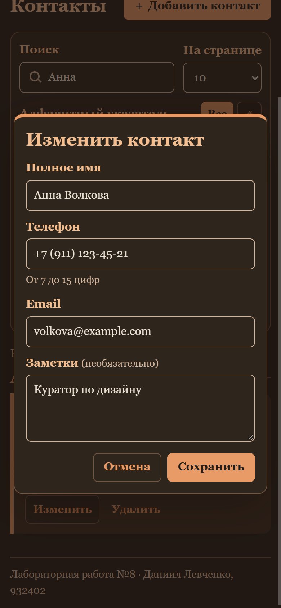

# Лабораторная работа № 8. Адресная книга

**Даниил Левченко, группа 932402 · Вариант 8 «Контакты»**

## Задача

Итоговый мини-проект курса продолжает адресную книгу из Lab 7. В приложении можно добавить контакт, просмотреть его карточку, изменить данные в модальном окне и удалить контакт после подтверждения. Поиск работает по имени, телефону и email. Алфавитный указатель группирует записи по первой букве имени и фильтрует список по кириллице, латинице или категории `#`.

## Стек и архитектура

| Компонент | Назначение |
| --- | --- |
| HTML, CSS и JavaScript в `public/` | Семантическая разметка, адаптивная сетка карточек, модальные окна `<dialog>` и запросы через `fetch` |
| Node.js 22.9+ и Express 5 в `src/app.js` | Раздача интерфейса, маршруты REST API, проверка входных данных |
| PostgreSQL и драйвер `pg` в `src/db.js` | Хранение контактов, поиск, фильтрация и пагинация |
| `schema.sql` и `src/server.js` | Создание таблицы при запуске и открытие HTTP-порта после подключения к БД |
| Web App Manifest и Service Worker | Установка в поддерживаемых браузерах и загрузка интерфейса без сети после первого успешного посещения |

Браузер обращается к Express API, а сервер выполняет параметризованные запросы в PostgreSQL. Данные контактов хранятся в БД. Service Worker кеширует файлы интерфейса. При недоступности сервера приложение показывает ошибку и кнопку «Повторить». В `localStorage` сохраняется выбранная тема.

Вёрстка продолжает Lab 5. Использованы Georgia, кремовый фон, терракотовые акценты и карточки с цветной левой полосой. Flexbox выравнивает элементы управления, CSS Grid перестраивает карточки с трёх колонок до одной.

## Схема базы данных

В базе `lab8_contacts` используется таблица `contacts`. SQL-определение находится в [schema.sql](schema.sql).

| Поле | Тип | Ограничения |
| --- | --- | --- |
| `id` | `INTEGER` | Первичный ключ, генерируется PostgreSQL как `IDENTITY` |
| `full_name` | `TEXT` | Обязательное имя, от 1 до 120 символов |
| `phone` | `TEXT` | Обязательный телефон, до 32 символов с форматированием |
| `email` | `TEXT` | Обязательный email, до 254 символов |
| `notes` | `TEXT` | Необязательный ввод, до 2000 символов, по умолчанию пустая строка |

Форма и API используют общую проверку полей. Телефон содержит от 7 до 15 цифр. Допустимы пробелы, скобки, дефисы и знак `+` в начале. Email проверяется на формат `name@example.com`. Телефон хранится с введённым форматированием, а при поиске учитывается также последовательность его цифр.

## Запуск

Понадобятся Node.js 22.9 или новее, npm и запущенный PostgreSQL.

1. В DBeaver откройте SQL-редактор для существующей базы, например `postgres`. В режиме **Auto-commit** выполните команду. Для неё нужна роль с правом создавать базы данных.

   ```sql
   CREATE DATABASE lab8_contacts;
   ```

2. В PowerShell из папки `web_labs` установите зависимости и создайте файл настроек.

   ```powershell
   cd lab8
   npm.cmd ci
   Copy-Item .env.example .env
   ```

3. В `.env` заполните `PGUSER` и `PGPASSWORD` данными подключения. При необходимости измените `PGHOST` и `PGPORT`. Роли нужно право создавать таблицу в `lab8_contacts`. По умолчанию приложение открывается на порту `3008` и использует отдельную от Lab 7 базу.

4. Запустите сервер. Он создаст таблицу из `schema.sql`, если её ещё нет. Откройте [адресную книгу](http://127.0.0.1:3008/).

   ```powershell
   npm.cmd start
   ```

## Скриншоты работы

### Карточки и алфавитный указатель



### Поиск по имени



### Редактирование на мобильном экране



## Маршруты

| Метод и путь | Действие | Успешный ответ |
| --- | --- | --- |
| `GET /api/contacts` | Получить список | `200 OK`, объект с `contacts`, `total`, `letters`, `page` и `limit` |
| `GET /api/contacts/:id` | Просмотреть один контакт | `200 OK` и контакт |
| `POST /api/contacts` | Добавить контакт | `201 Created` и новый контакт |
| `PUT /api/contacts/:id` | Обновить контакт | `200 OK` и обновлённый контакт |
| `DELETE /api/contacts/:id` | Удалить контакт | `204 No Content` |

Запрос списка принимает `q` для поиска и `letter` для выбора группы. Допустима одна русская или английская буква в любом регистре. Группа `#` объединяет имена, начинающиеся с других символов. В URL она передаётся как `letter=%23`. Значения по умолчанию для пагинации — `page=1` и `limit=10`, максимальный размер страницы — 50.

Поле `total` показывает число совпадений с поиском и выбранной буквой до пагинации. В `letters` приходят все группы, подходящие под поиск, чтобы указатель учитывал записи на других страницах. Результаты упорядочены по алфавитной группе и имени.

Для `POST` и `PUT` передаются строки `full_name`, `phone`, `email` и необязательная строка `notes`. При обновлении без `notes` заметка очищается. Ошибки в аргументах или данных возвращают `400 Bad Request`. Запрос отсутствующей записи по ID возвращает `404 Not Found`.

## Проверка через PowerShell

```powershell
$api = 'http://127.0.0.1:3008/api/contacts'
$json = 'application/json; charset=utf-8'
$body = @{
  full_name = 'Анна Волкова'
  phone = '+7 (900) 123-45-67'
  email = 'anna@example.com'
  notes = 'Учебный контакт'
}
$created = Invoke-RestMethod $api -Method Post -ContentType $json -Body ($body | ConvertTo-Json)
$url = "$api/$($created.id)"

Invoke-RestMethod "${api}?q=900123&letter=$([uri]::EscapeDataString('А'))"
Invoke-RestMethod $url

$body.notes = 'Обновлённая заметка'
Invoke-RestMethod $url -Method Put -ContentType $json -Body ($body | ConvertTo-Json)
Invoke-RestMethod $url -Method Delete

# Ожидается HTTP 400
Invoke-RestMethod "${api}?limit=-1"
```

## Ревью кода

| Критерий | Что проверено |
| --- | --- |
| Читаемость | HTTP-маршруты, SQL-запросы, интерфейс и общая валидация разделены по файлам |
| Семантика | Группы имеют заголовки, контакты размечены как `article`, телефон и email доступны как ссылки |
| Доступность | Поля подписаны через `label`, у кнопок карточек есть имя контакта, у фильтров есть `aria-pressed`. Диалоги поддерживают клавиатуру, видимый фокус и закрытие по Escape |
| Производительность | Поиск отложен на 200 мс после ввода, предыдущий запрос отменяется. Сервер возвращает страницу до 50 карточек и вычисляет число совпадений в том же запросе. Поиск по подстроке просматривает записи и рассчитан на размер учебной адресной книги |

Для проверки PWA откройте главную при запущенном сервере, дождитесь активации Service Worker в DevTools и перезагрузите страницу с включённым режимом **Offline**. Интерфейс откроется, а список покажет ошибку подключения. После возврата в сеть список загрузится снова.
